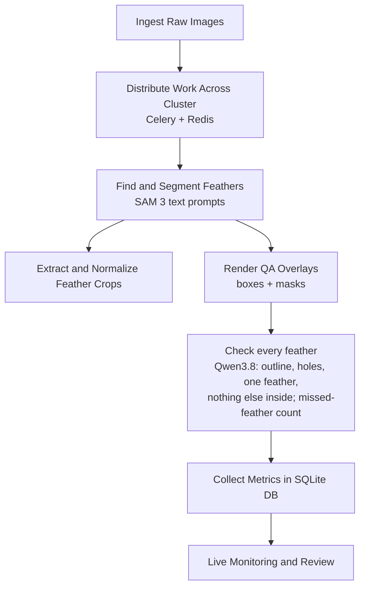

# Feather Molt Analysis Pipeline

A distributed feather segmentation pipeline for a scalable cluster of Celery workers using a Redis-backed task queue.

## Workflow Architecture


1. Ingest slide images and dispatch each image as an independent task to a scalable worker cluster.
2. Find and segment every feather with `SAM 3` concept segmentation from a text prompt ("bird feather").
   `FEATHER_SEGMENTER=dino_sam2` switches to the original Grounding DINO boxes + SAM 2.1 masks.
3. Post-process masks into clean feather crops, apply basic normalization, and persist run outputs.
4. Generate QA overlays and check each feather with the vision-language model (`Qwen3.8-27B` on MLX): outline complete on every side, no holes or gaps (also measured on the mask), exactly one feather and not a fragment, no other feather or material inside. A slide-level inventory flags feathers the segmentation may have missed, for review only. A 1-10 score is computed from the checks with fixed deductions (`configs/segmentation.json`) for sorting; retries and review use the checks. The old slide-level judge (metadata plus one overlay score) is retired.
5. Parse specimen metadata from structured sources first, with VLM fallback when metadata is missing.
6. Persist per-image outcomes (timings, counts, QA flags, notes, retry decisions) into SQLite for queryable run history.
7. Drive dashboards and review notebooks from database state so monitoring is tied to recorded pipeline results, not transient filesystem scans.

## Project Structure
- `data/raw/`: Input feather `.jpg` files.
- `data/processed/`: Output segmented feather crops.
- `src/full_run_distributed.py`: Dispatches all image tasks to the cluster.
- `src/celery_tasks.py`: Distributed task definitions.
- `src/feather_processing.py`: Core segmentation and extraction logic.
- `run_cluster.sh`: Bootstraps Redis, Celery workers, Flower, and starts the pipeline.

## Setup
Every node (head, workers) and every machine you drive runs from uses the same
[pixi](https://pixi.sh) environment (macOS on Apple silicon or Linux; MLX is only
installed on Apple silicon, where the VLM runs):

```bash
pixi install
pixi run setup        # R packages not on conda-forge (pavo, lightr)
cp .env.example .env  # head/worker hosts, SSH user/key, broker URL, VLM settings
```

SAM 3 weights are gated: request access at https://huggingface.co/facebook/sam3 and put
`sam3.pt` in the repo root on each worker. Without it the workers fall back to
`dino_sam2`.

## Node roles
| Role | Command | Notes |
|---|---|---|
| Broker (head) | `pixi run redis` | password taken from `BROKER_URL` |
| Worker (each node) | `pixi run worker` | `WORKER_CONCURRENCY`, default 1 |
| Dashboard (head) | `pixi run flower` | `http://<head>:5555` |
| VLM server (Apple silicon) | `pixi run vlm-server` | OpenAI-compatible, `:8790`, model `FEATHER_VLM_MODEL` |
| JupyterLab | `pixi run jupyter` | `:8889` |

## Cluster Run
1. Fill in `.env` (hosts, SSH, broker).
2. Place all feather images in `data/raw/` on the head.
3. Deploy and launch: the repo and environment are installed on every node, images are
   synced to the workers, then the broker, workers, dashboard and pipeline start.
   ```bash
   ./run_cluster.sh            # Celery: tasks are spread over all workers
   ./run_cluster_sharded.sh    # or: one fixed shard of data/raw per node
   ```
   If your workers are kept running by a service manager, set `FEATHER_MANAGE_WORKERS=0`.

## Monitoring
- Flower dashboard: `http://<head>:5555`
- Pipeline log on the head: `distributed_pipeline.log`
- Worker logs on each node: `celery_worker.log`
- `./monitor_cluster.sh`: memory pressure per node
- `pixi run check`: broker, workers and SSH reachability from this machine

## Driving runs from a notebook
Any machine with the environment and `.env` can submit work and inspect results while the
data and models stay on the cluster:

```bash
python -m src.submit_remote_pipeline \
  --remote-input-dir ~/bird-feather-analysis/data/raw \
  --remote-output-dir ~/bird-feather-analysis/data/processed
```

### Fast loop: label table and sample runs
- **Label table** (second output table: bird ID, species, age, sex, date read from the
  original slide): open `notebooks/label_lab.ipynb`, set the parameters in the first cell, run.
  Regions, prompts and format rules live in `configs/label_fields.json`; edit and re-run, no
  restart. Hand-checked answers in `data/label_gold.csv` give per-field accuracy on every run.
  CLI: `pixi run labels -- --sample 10 --seed 1`, all slides: `pixi run labels-all`.
  Fixed 30-slide benchmark (spread over ID prefixes and years, scored against the gold file):
  `pixi run labels -- --manifest configs/label_sample_30.txt --gold data/label_gold.csv`.
  Each field tries its primary crop, an expanded crop, then wider `fallback_regions`; the ID and
  date are read twice and disagreements go to review. `file_id` (the file name) and
  `bird_id` (the code printed top-center on the label) are separate columns; the ID and year parsed
  from the file name are only a cross-check or a labelled `filename_fallback`. `N/A` means the
  field is not on the slide; a failed model request is `model_error` and stays blank. A run
  directory holds `labels.csv`, `review.csv`, `labels.jsonl` (full detail), `labels.sqlite3`
  (`specimen_labels` table), `summary.json` and the evidence crops; rerunning with the same
  `--out` skips finished slides and retries model errors.
  Feather IDs (`<bird_id>_<year>_<letter>`, A, B, ... left to right, e.g. `A0012H_1996_A`) come
  from segmentation: workers assign them to the crops they keep (`specimen_feathers` table);
  for a label-only run pass `--segmentation-dir data/sample_runs/<id>` from `pixi run sample-run`.
  The red/blue text line under the label boxes and the code above the date are ignored.
- **Output file names** (`src/output_names.py`): slide `CE01168 2008-im2346.jpg` gives
  `CE01168 2008_BoundingBoxes.jpg` and crops `CE01168_2008_Feather_A.jpg`, `..._B.jpg`, ... (A = leftmost),
  from the file name's ID and year. A bird with several slides in one year (63 slides) uses the full
  label date instead of the year, in file names and feather IDs (`BB17692_19980612_Feather_A.jpg`,
  `BB17692H_19980612_A`); slides of the same bird from the same day also get the image number
  (`A0514_20000521-im1163_Feather_A.jpg`), as do slides whose own date cannot be read.
- **Duplicate feathers** (`src/feather_duplicates.py`): same-day slides of one bird often repeat a
  feather in another order, position or rotation. Each repeat gets `duplicate_of` (the first
  occurrence: earliest image number, then letter) in `feathers.csv`, `specimen_feathers` and
  `feather_duplicates.csv`. Matching uses feather size plus SIFT keypoints fitted to one
  rotation/shift (mirror images too). Post-run on gathered outputs:
  `python -m src.feather_duplicates <processed_dir>`. Lookups also find the older
  `<slide>_<id>_<date>_Feather_<n>.jpg` names of earlier runs.
  The model is served by `pixi run vlm-server`; point `FEATHER_VLM_ENDPOINTS` at it.
- **Label table in cluster runs**: every `process_image` task (Celery) and every sharded run
  reads the label first, from the original slide, and keeps going with segmentation whatever
  the label outcome. Workers reuse their loaded Qwen model (`FEATHER_LABEL_VLM=auto`), cache
  each slide's result and evidence under `<output_dir>/labels/`, and the run stores one
  `specimen_labels` row per slide in `pipeline_metrics/run_stats.sqlite3` (sharded) or writes
  `<output_dir>/labels/labels.csv` etc. on the driver (Celery). `labels_*` counters go to the
  run's local state, JSONL events and Redis totals; model errors are counted apart from fields
  that are not on the slide. Label-only runs on the workers:
  `pixi run labels -- --manifest configs/label_sample_30.txt --distributed --gold data/label_gold.csv`.
  `FEATHER_ENABLE_LABELS=0` turns it off.
- **Sample segmentation runs**: `pixi run sample-run -- --n 5` (or `--match "A0012 1996"`) sends
  slides through the workers' normal pipeline and copies the outputs to `data/sample_runs/`.
  Their run ids start with `test-`.

### Archiving runs
`pixi run sync-runs` asks the head node to archive finished runs (`pixi run sync-status`
shows the last result). Test runs (`max_images` other than `all`, or ids containing
test/smoke/debug/tmp) are skipped.
